# PINN Evaluation Report
This report audits the Physics-Informed Neural Network after mathematical fixes.

## Evaluation Metrics
| Target | MAE | RMSE | WMAPE | R2 |
|---|---|---|---|---|
| Density | 0.00 | 0.00 | 1.84% | 0.9963 |
| Queue Length | 6.46 | 8.62 | 4.59% | 0.9861 |
| Throughput | 2.40 | 3.14 | 62.26% | 0.3416 |
| Average Speed | 0.64 | 0.88 | 14.04% | 0.8643 |
| Fuel Consumption | 3330.93 | 4407.38 | 3.83% | 0.9818 |

## Diagnostic Plots
### Density
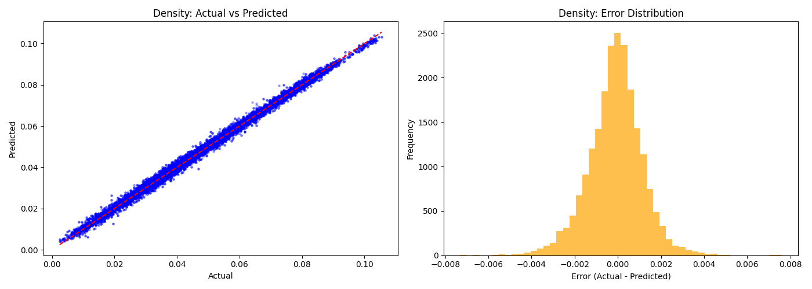
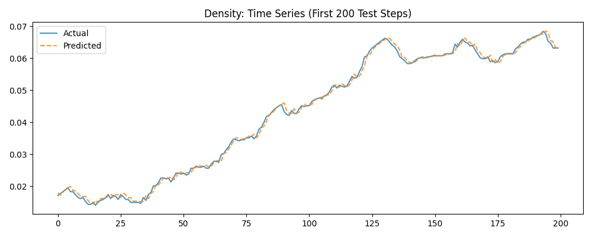

### Queue Length
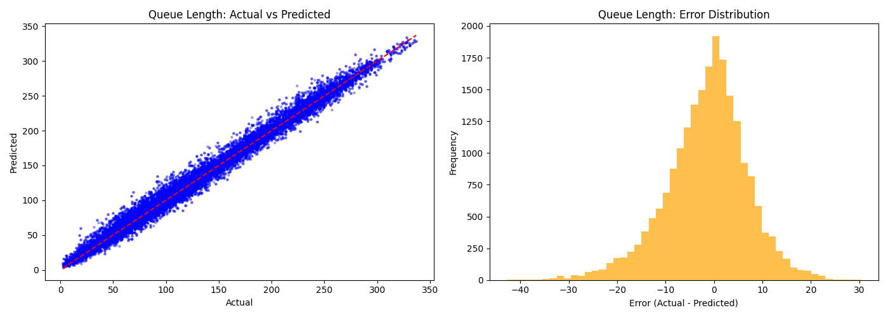
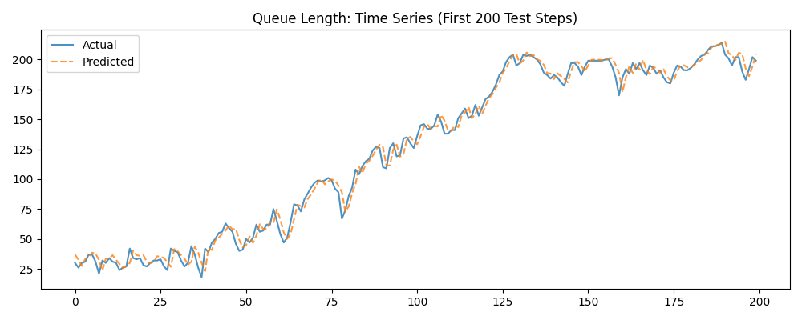

### Throughput
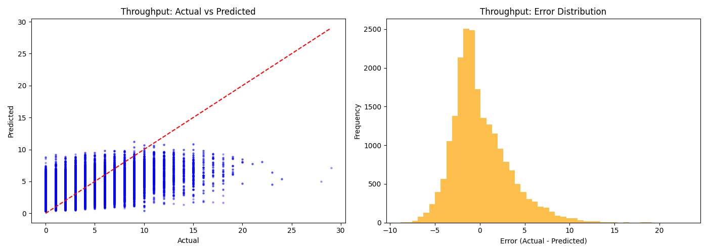
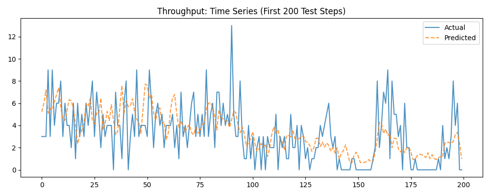

### Average Speed
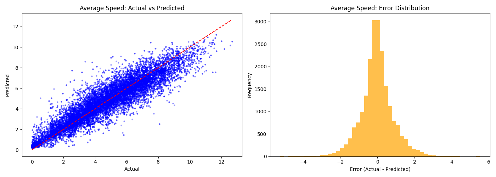
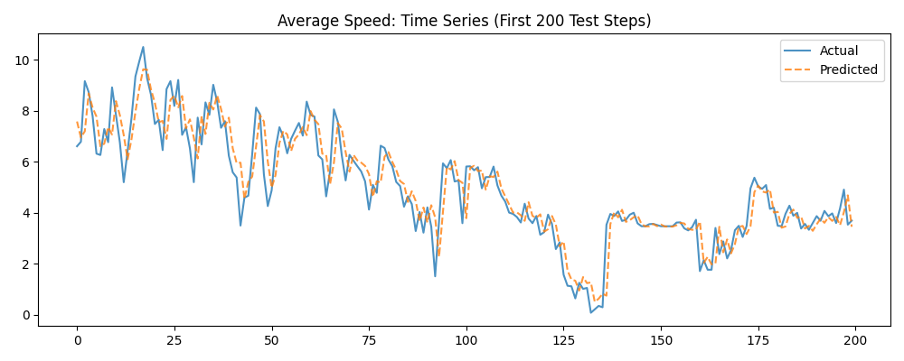

### Fuel Consumption
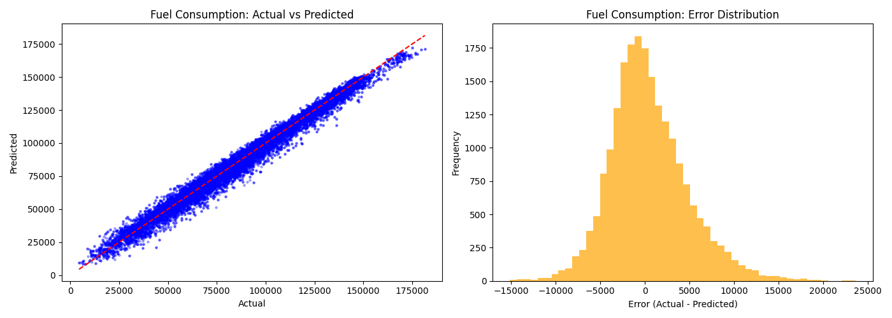
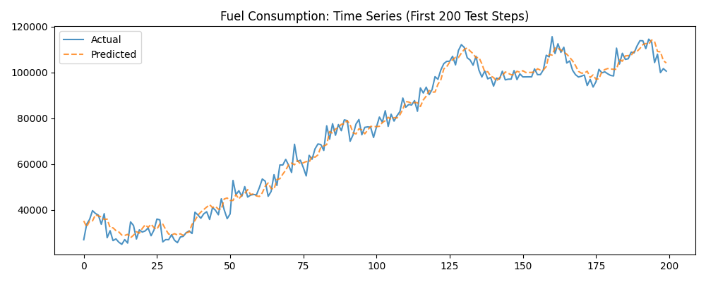

## Physics Loss Audit
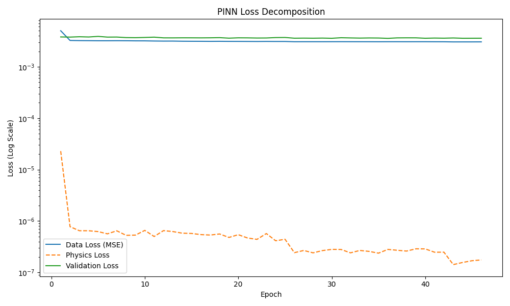
If the Physics Loss declines alongside Data Loss, it means the network is successfully internalizing the traffic flow continuity equation constraint, anchoring the predictions in reality.