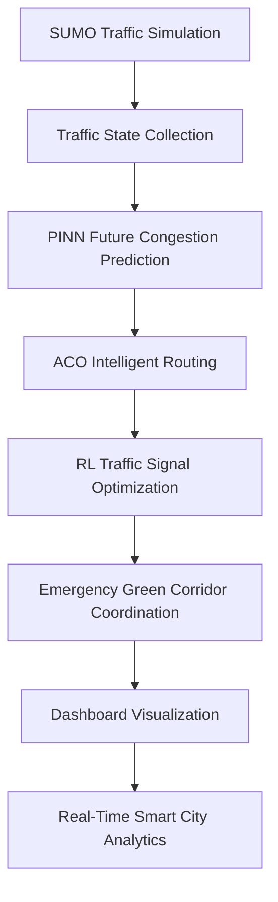

# System Architecture

The system combines a SUMO digital twin, RL signal control, PINN congestion forecasting, ACO route optimization, and emergency corridor coordination. The dashboard reads the latest metrics and benchmark artifacts for presentation and evaluation.